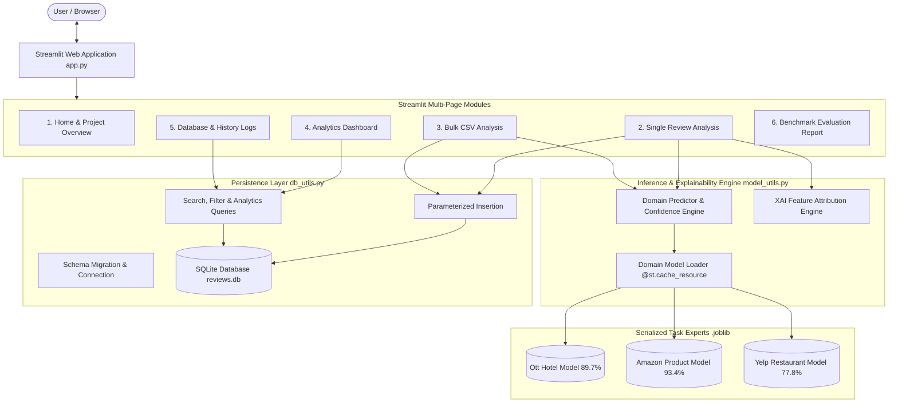
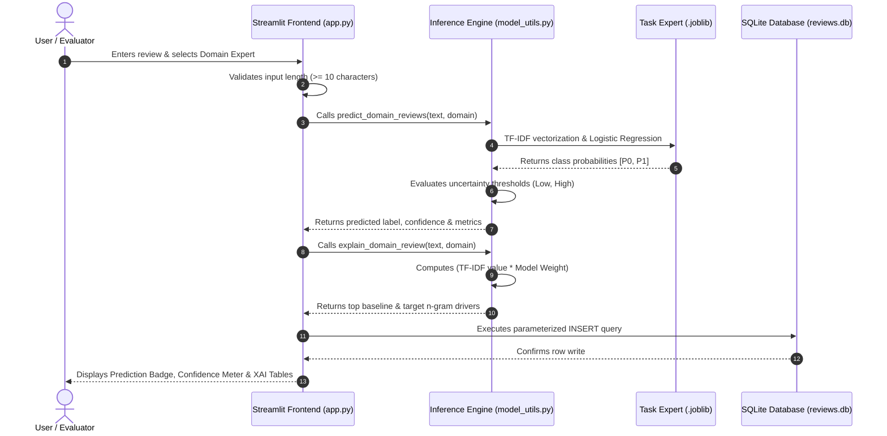

# System Architecture & Technical Specifications

# Fake Review Detection and Review Reliability Analysis System

**Institution:** Punjab Engineering College (PEC)  
**Project Team:** Himanshi (SID: 24106002), Samarth (SID: 24106046) &nbsp;|&nbsp; **Branch:** CSE (Data Science)  
**Document:** System Architecture, Data Flow, and Component Design  

---

## 1. High-Level Architecture Overview

ReviewTrust is structured into a modular three-tier software architecture comprising a Presentation Layer (Streamlit), an Inference & Explainability Engine (Scikit-learn), and a Relational Persistence Layer (SQLite):



---

## 2. Component Design & Responsibilities

### 2.1 Presentation Layer (`app.py`)
- **Navigation Dispatcher:** Sidebar radio controller managing six distinct operational modules.
- **Dynamic Domain Selector:** Selects between Hotel, Product, and Restaurant models, displaying relevant metadata and test metrics.
- **Input Controllers:** Handles single-review text areas (with 1-click sample review prefill buttons) and multi-column CSV file uploads.
- **Output Renderers:** Renders classification badges, continuous confidence bars, feature attribution dataframes, highlighted text, and analytical bar charts.

### 2.2 Inference & Explainability Engine (`model_utils.py`)
- **Domain Specifications (`DOMAIN_CONFIGS`):** Centralized registry mapping domain keys to model paths, class names, test accuracies, threshold definitions, sample reviews, and limitations.
- **Model Loader (`load_domain_model`):** Deserializes scikit-learn pipelines with memory caching (`@st.cache_resource`) to guarantee instantaneous subsequent inferences without reloading disk weights.
- **Prediction Pipeline (`predict_domain_reviews`):**
  1. Imputes and validates input text strings.
  2. Applies fitted TF-IDF unigram and bigram tokenization.
  3. Computes class probabilities via logistic sigmoid activation.
  4. Applies three-tier uncertainty thresholding.
  5. Computes confidence scores ($\max(P_0, P_1)$).
- **Explainable AI Engine (`explain_domain_review`):**
  - Multiplies active non-zero TF-IDF values by logistic regression feature weights.
  - Segregates positive drivers (pushing towards target class) and negative drivers (pushing towards baseline class).
  - Sorts and extracts top-$k$ influential n-gram terms for visual highlighting.

### 2.3 Persistence Layer (`db_utils.py`)
- **Schema Management:** Automatically creates and validates the `review_predictions` table upon application startup.
- **Parameterized Security:** Ensures all user texts and classification scores are passed using SQL parameterized placeholders (`?`), preventing SQL injection attacks.
- **Audit Analytics:** Computes aggregated key performance indicators (total review counts, domain distribution, average confidence, recent analyses) directly using SQL aggregation.

---

## 3. End-to-End Prediction Data Flow

The sequence diagram below illustrates the exact step-by-step data flow from user input to explainability and persistence:



---

## 4. Database Schema Specifications

The relational schema is implemented in SQLite (`reviews.db`):

| Column Name | Data Type | Nullable | Description |
| :--- | :--- | :---: | :--- |
| `id` | `INTEGER` | NO | Primary Key, Auto-incrementing unique identifier |
| `review_text` | `TEXT` | NO | Full text content of the evaluated review |
| `domain` | `TEXT` | NO | Evaluated domain expert (e.g. 'Hotel Reviews', 'Product Reviews') |
| `model_name` | `TEXT` | NO | Specific task name (e.g. 'Ott Hotel Deception Model') |
| `predicted_label` | `TEXT` | NO | Categorical output (e.g. 'Truthful', 'Deceptive', 'Human-Written (OR)', 'Recommended (N)') |
| `raw_prediction` | `TEXT` | YES | Raw binary class label from classifier |
| `confidence` | `REAL` | NO | Maximum posterior probability ($\max(P_0, P_1)$) |
| `prob_baseline` | `REAL` | NO | Posterior probability of baseline class ($P_0$) |
| `prob_target` | `REAL` | NO | Posterior probability of target class ($P_1$) |
| `p_deceptive` | `REAL` | YES | Backwards-compatible target probability column |
| `p_truthful` | `REAL` | YES | Backwards-compatible baseline probability column |
| `reliability_score`| `REAL` | YES | Continuous heuristic score ($100 \times P_0$) |
| `source` | `TEXT` | NO | Origin of record ('single' or 'bulk CSV') |
| `created_at` | `TEXT` | NO | ISO 8601 UTC/Local timestamp of inference |

---

## 5. Security & Stability Considerations

1. **SQL Injection Defense:** All queries in `db_utils.py` strictly employ parameterized binding:
   ```python
   cursor.execute("INSERT INTO review_predictions (...) VALUES (?, ?, ?, ...)", values)
   ```
2. **Defensive Input Validation:**
   - Empty or whitespace-only inputs are trapped and prevented from reaching model inference.
   - Short text snippets ($< 10$ characters) trigger non-blocking user warnings.
3. **Memory Optimization:** Serialized pipelines are cached in RAM via Streamlit's `@st.cache_resource`, ensuring negligible CPU overhead during live demonstrations.
4. **Data Immutability:** Pre-trained models and prepared dataset files are opened in read-only mode during web application execution, guaranteeing zero tampering with baseline artifacts.
